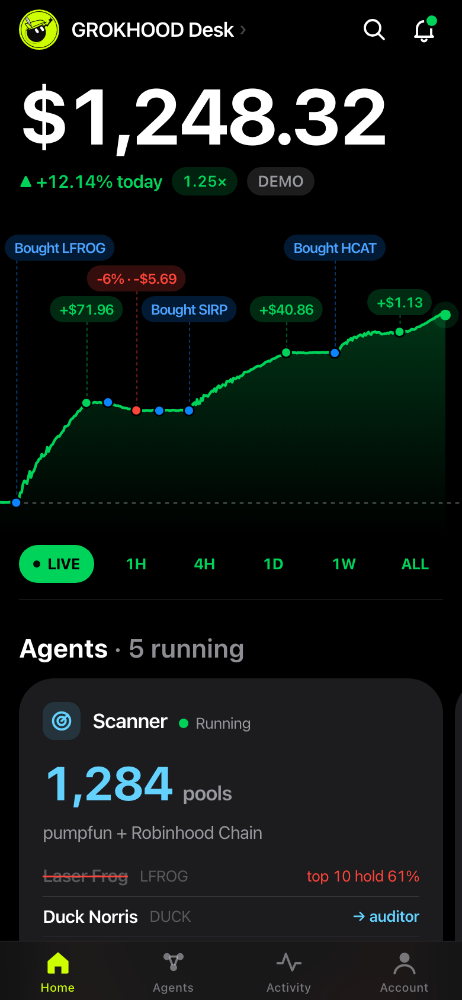
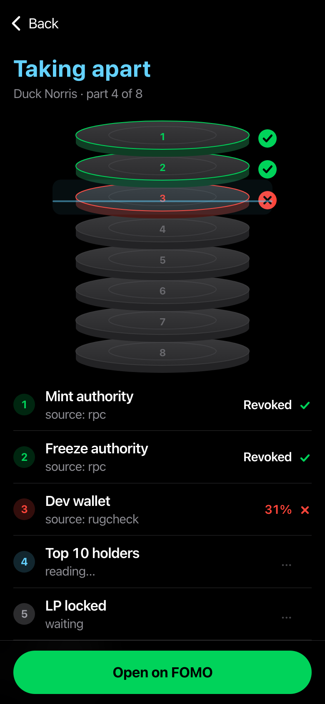
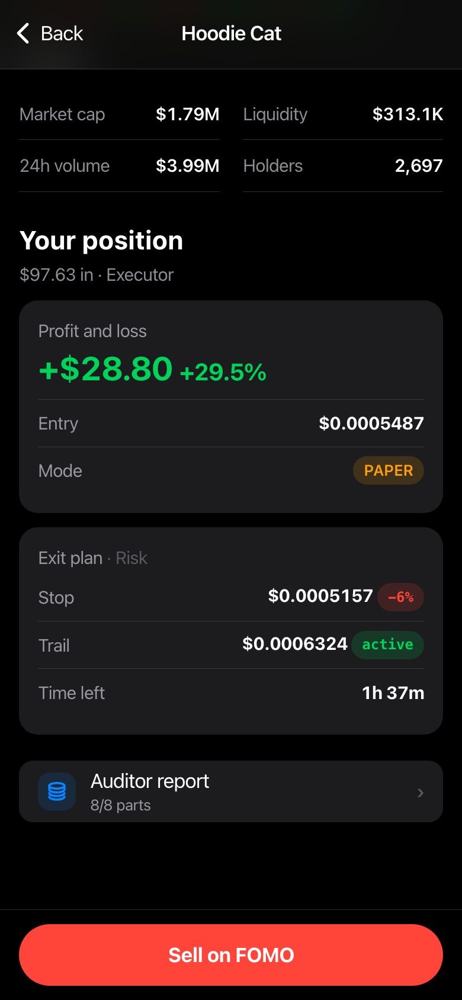

<p align="center"></p>

# GROKHOOD Desk

Five AI agents that find, take apart, judge, size and guard new memecoins on **Solana** (pumpfun graduates) and **Robinhood Chain** (Pons launches scored by [GROKHOOD](https://grokhood.tech)), plus a copy bot that follows the best FOMO traders. You get one button. You tap it.

The desk never places an order and never holds a key. FOMO has no public order API, so every signal ends with a **Buy on FOMO** / **Sell on FOMO** button that opens the coin in FOMO, where you trade yourself.

<p align="center">



</p>

## The pipeline

| Agent | Job | Sources |
|---|---|---|
| **Scanner** | Hears every pumpfun graduation and every graduated Pons launch, waits for the pool to age, kills thin, concentrated, overheated and copycat coins | PumpPortal migrations, DexScreener, GROKHOOD stream |
| **Auditor** | Takes each coin apart in 8 layers, one red layer kills it | Solana RPC, RugCheck; GROKHOOD Safety Score, rings, known operators, insider dump alerts |
| **Analyst** | Asks 4 closed questions (alive in 6h, organic buyers, flush being absorbed, chasing a run), code applies the gate | Grok (xAI, structured output, daily budget) or a free rules mode |
| **Executor** | Sizes the ticket (% of stack, capped by pool liquidity, FOMO fee tiers), re-checks, sends the button | DexScreener |
| **Risk** | Polls every open position, stop, trailing stop, dead-money timeout, sends the Sell button | DexScreener |

**Solana audit layers:** mint authority, freeze authority, dev wallet (share + sold since migration), top 10 holders without pool and curve, LP locked or burned, pool age, bundled wallets (biggest funding cluster), token delegations (Token + Token-2022 accounts grouped by delegate).

**Robinhood Chain audit layers (GROKHOOD):** Safety Score, rug rings, known operators, dev wallet, top 10 holders, snipe-tax exempt wallets, linked clusters, insider dump alerts.

Every reject names the agent, the layer or rule and the value: `Auditor · dev holds 31%`, `Analyst · chase 0.41`.

## The app

A black iOS web app you add to your home screen: live balance with an odometer, a hand-drawn canvas chart with buy and exit marks, a carousel of the 5 agents working in real time, the Auditor taking a coin apart layer by layer, live candles with the Risk exit line, and every setting as a slider. Push notifications through Telegram and Web Push, each with its FOMO button.

## Copy bot

`copybot/` is a private Telegram bot that watches FOMO traders you follow (import the top 30 of the 7d and 30d boards) and sends every trade as a card with a **Copy** button, plus a breaking card when several of them buy the same coin. Robinhood Chain coins get their GROKHOOD Safety Score on the card.

It reads FOMO's own app API, which is unofficial and can break any day, with a session token from a **separate, empty** FOMO account. Never use your trading account's token.

## Run it

```bash
python3 -m venv .venv && .venv/bin/pip install httpx websockets fastapi uvicorn pydantic pywebpush
cp .env.example .env          # optional keys: XAI_API_KEY, TG_TOKEN, FOMO_REF
.venv/bin/python scripts/probe.py   # proves every data source answers
.venv/bin/python -m desk.main       # prints the app URL once
```

Open the printed URL on your phone, then Share, Add to Home Screen. The desk starts in **PAPER** mode with a simulated stack, real prices and real FOMO fees. LIVE unlocks only after one full PAPER night and typing `LIVE`.

Talk to it in Telegram: `why X`, `buy X`, `set stop to -8%`, `pause scanner`, `status`, `report`.

## Honest notes

- This is a tool, not a strategy. The Auditor makes rugs rarer, it does not make them impossible.
- PAPER exits at the real polled price, gaps included.
- Public Solana RPC works today for every layer; if your RPC refuses `getProgramAccounts`, layer 8 turns every coin red until you point `desk.rpc_url` at one that allows it.
- No number on screen is made up: missing data shows as n/a.

## Layout

```
desk/        agents/, sources/, api.py, telegram.py, notify.py, report.py, web/
copybot/     FOMO trader tracker + Telegram bot
docs/        ARCHITECTURE.md (contracts), FIELDS.md (raw key mapping), COSTS.md
scripts/     probe.py
```

Tests: `python -m pytest desk/tests copybot/tests -q`
